# UI Screenshots

Captured from the running system with the demo data (WBS 1.6.2). The demo bookings are dated relative to the import day, so dates in your copy will differ.

To retake them after design changes, open the same pages while logged in as the demo accounts listed in [GETTING-STARTED.md](../GETTING-STARTED.md#demo-accounts).

## Public & customer pages

### 1. Home
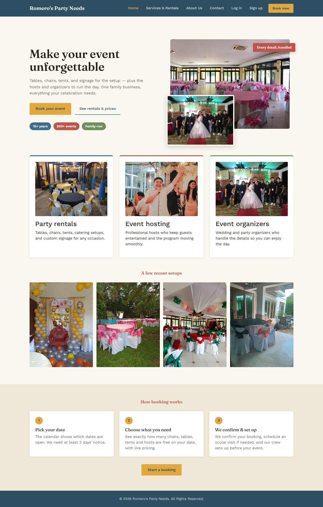

### 2. Services & rentals: checking availability for a date
Prices and stock come from the database. Picking a date shows how many of each item are still free.
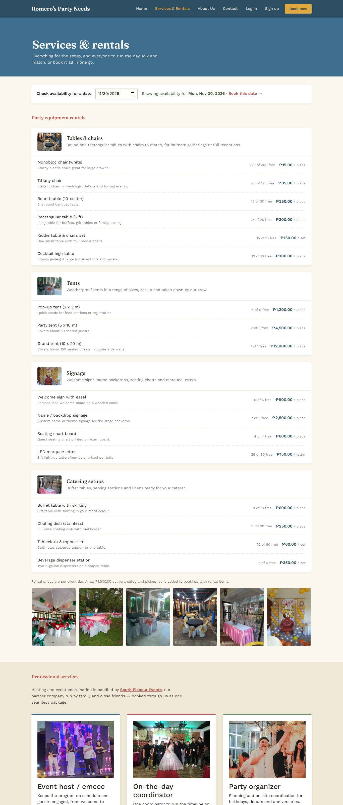

### 3. Booking form
Availability calendar (green open, yellow almost full, red full/closed), live stock per item, fully booked services disabled, running total and down payment.
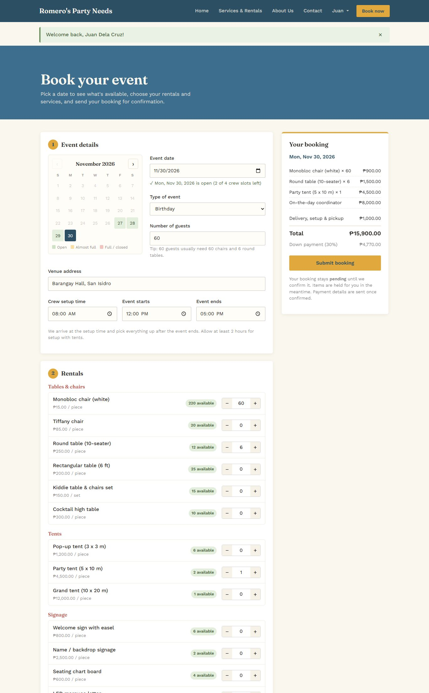

### 4. Booking details (customer)
Status and payment badges, setup schedule, items, payments, linked appointment and timeline.
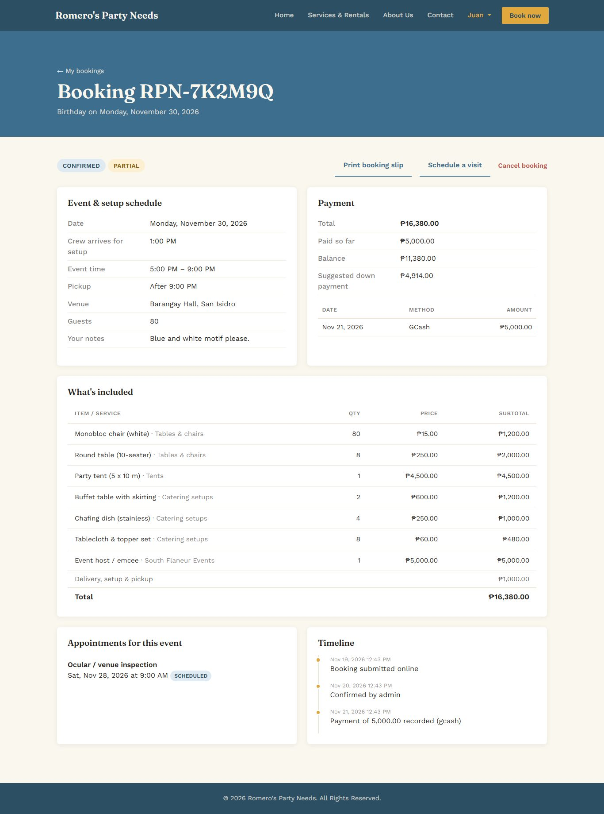

### 5. Editing a pending booking
Same form, pre-filled. Availability already counts what this booking holds, so it doesn't block itself.
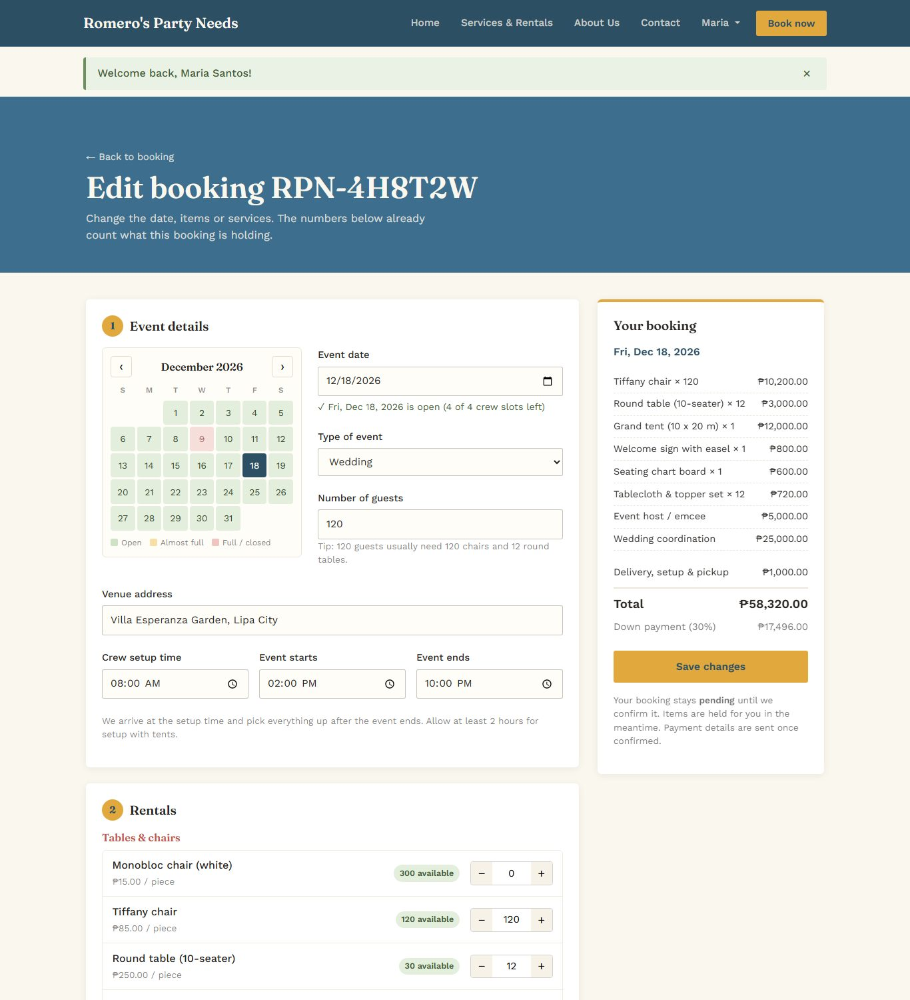

### 6. My bookings (customer dashboard)
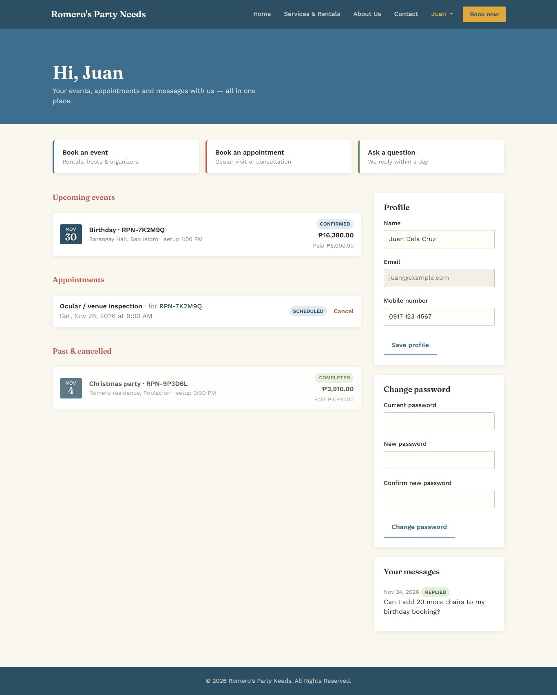

### 7. Booking an appointment
Taken slots are crossed out. Appointments can be linked to a booking.
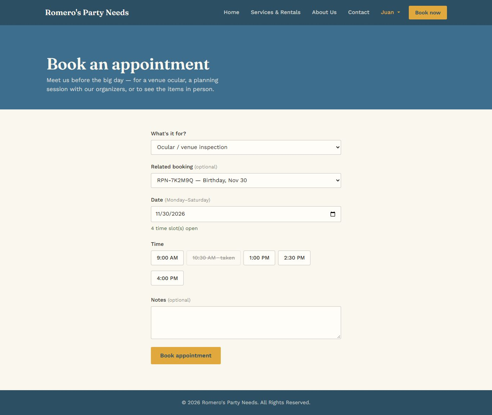

### 14. Booking form on a phone
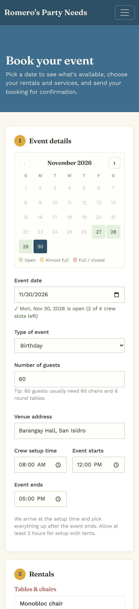

## Admin back office

### 8. Dashboard
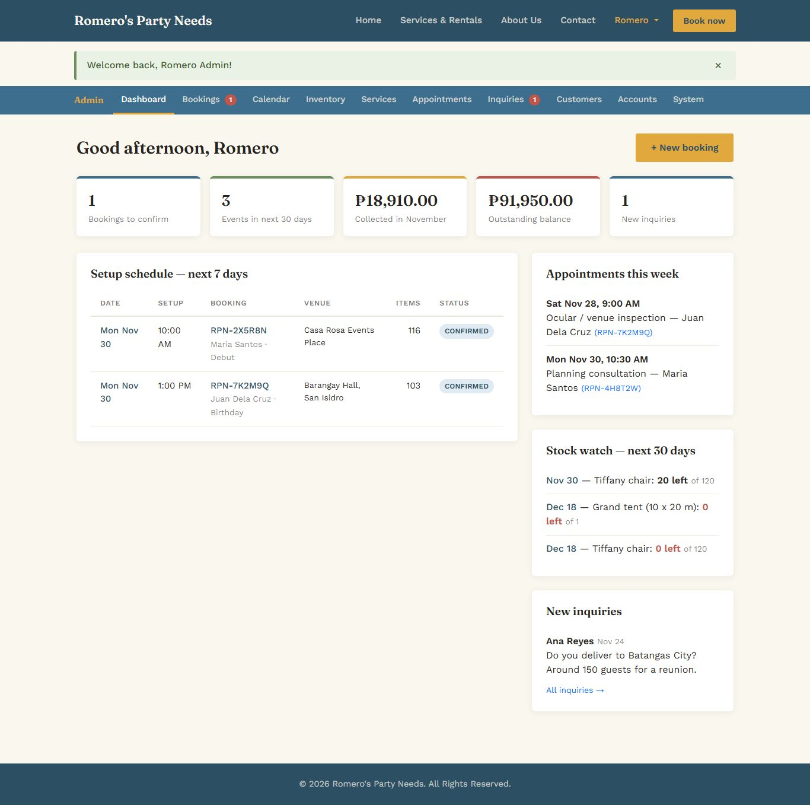

### 9. Managing a booking
Confirm / complete / cancel, record payments, reschedule, internal notes, timeline.
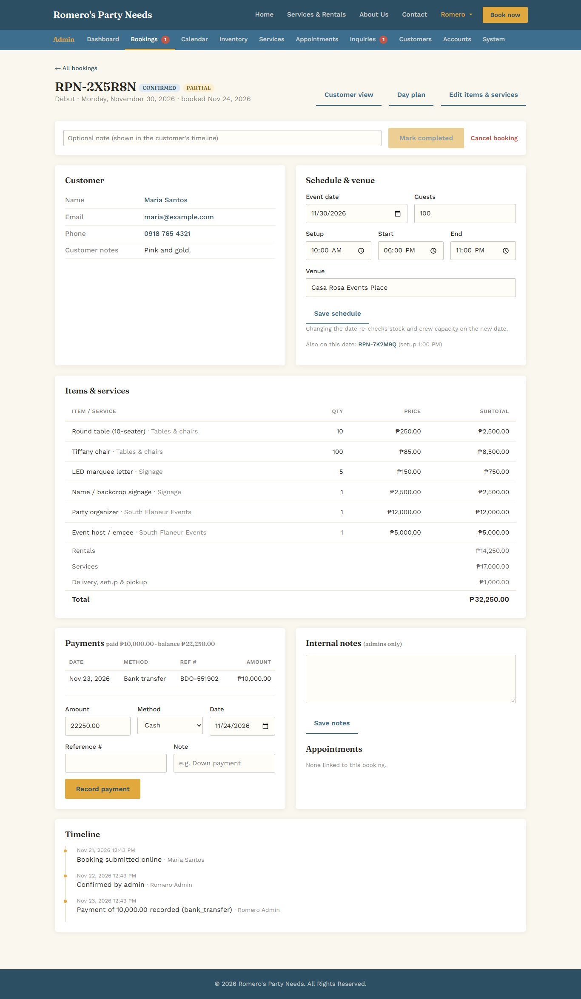

### 10. Calendar and day plan
Every setup that day in time order, plus the truck load list across all bookings.
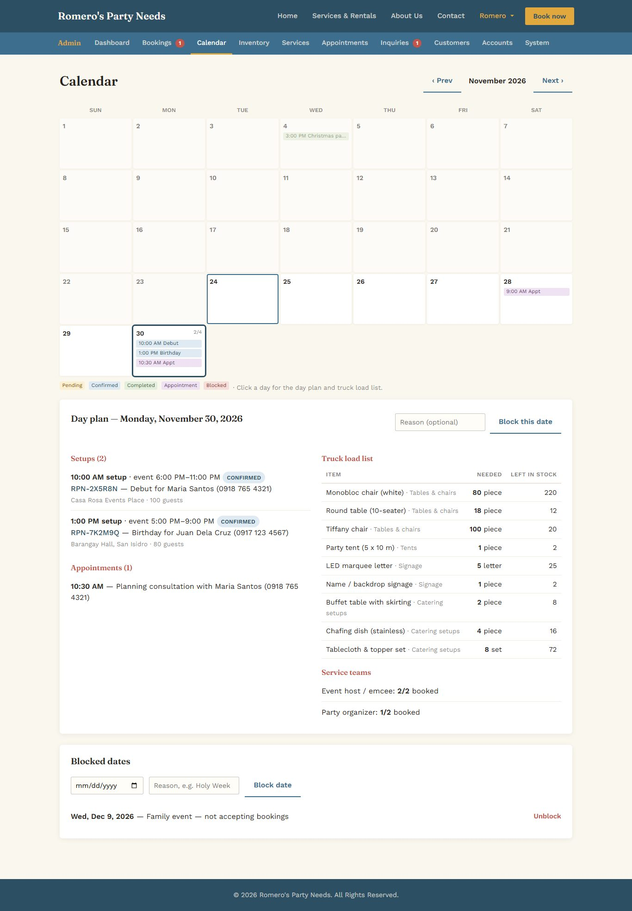

### 11. Inventory
Owned vs booked vs free on any chosen date. Add/edit items with photos.
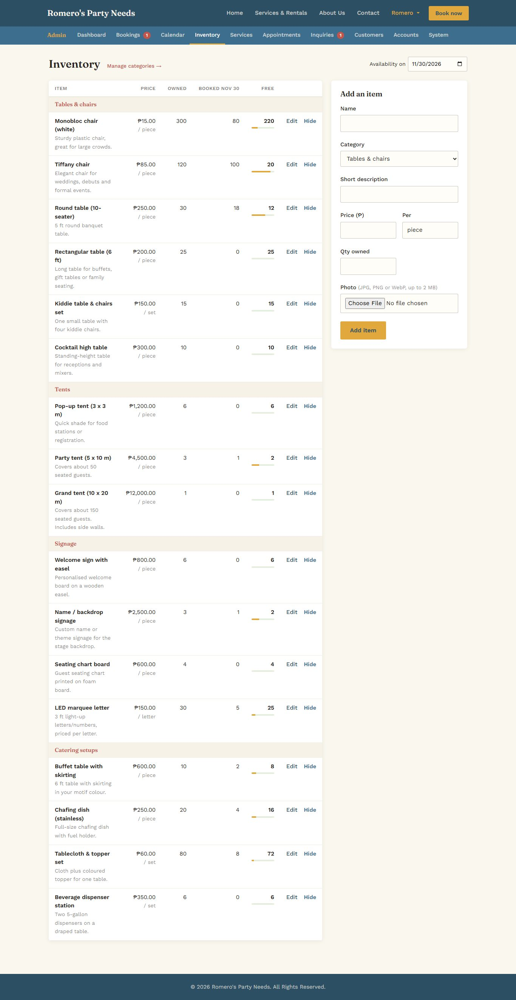

### 12. Accounts & roles
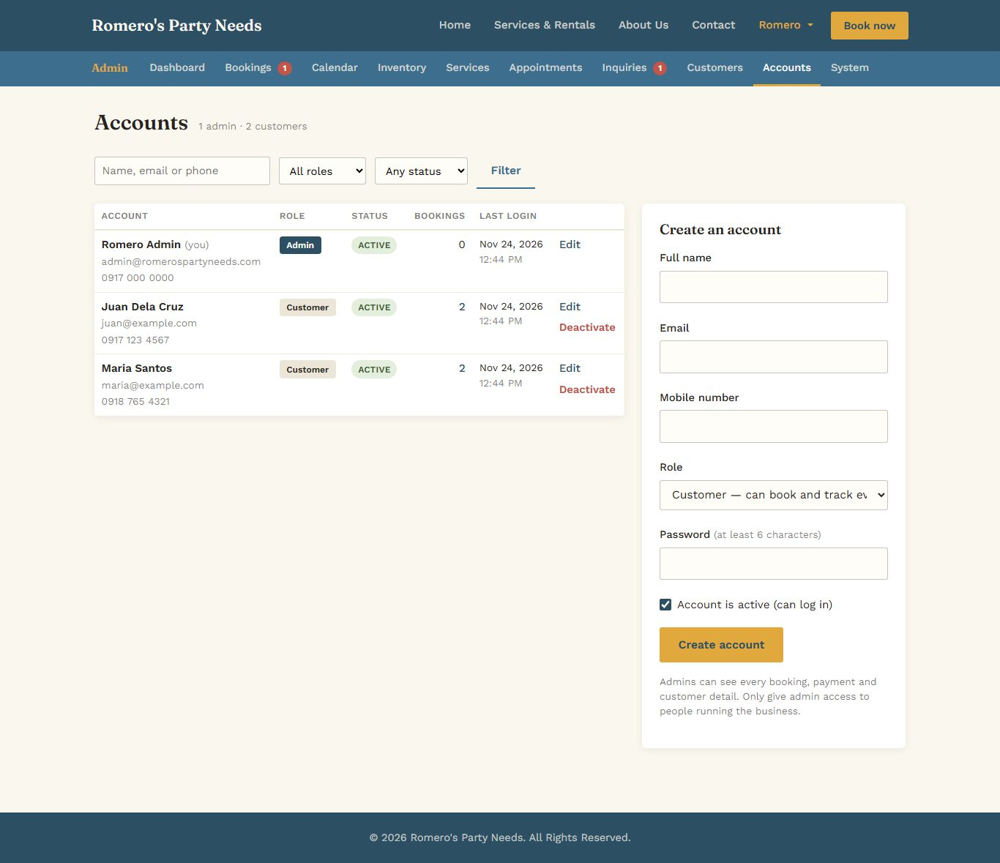

### 13. System check (for deployment)
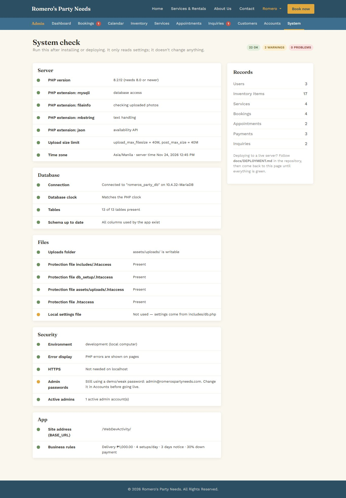
