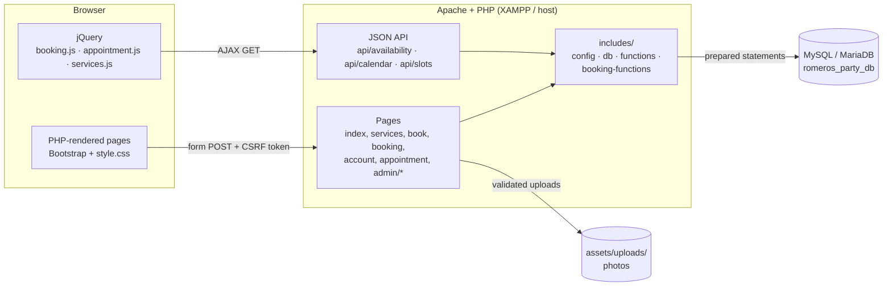
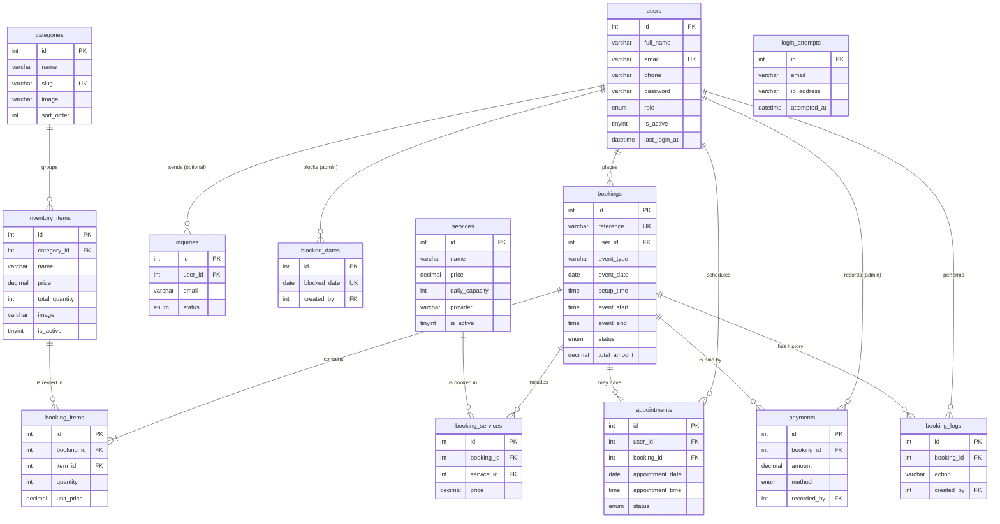
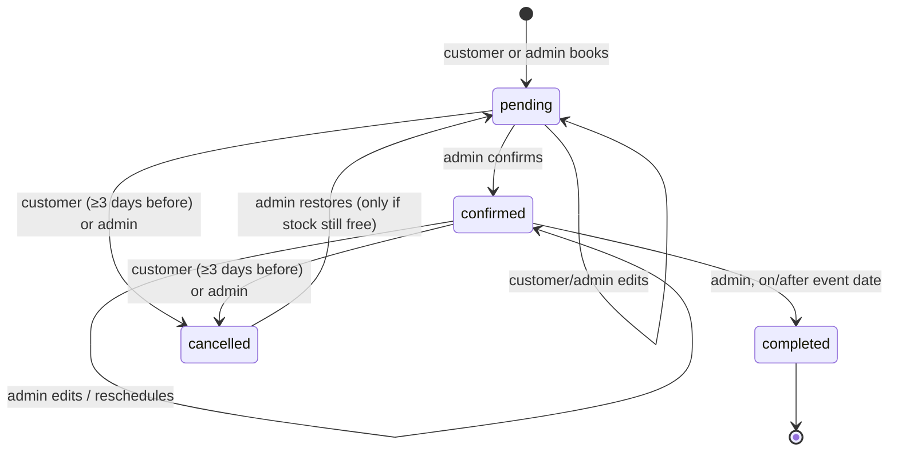

# System Overview, ERD & Data Dictionary

**Project:** Romero's Party Needs Web Platform (WBS 1.6.1)
**Stack:** PHP 8 (procedural, `mysqli` prepared statements) · MySQL/MariaDB · HTML5/CSS3 · Bootstrap 5 · jQuery

---

## 1. Purpose

Romero's Party Needs is a family-owned party rental business: tables, chairs, tents, signage and catering setups. Its partner company, South Flaneur Events, provides event hosts and wedding/party organizers.

Before this system, bookings were handled through chat and phone calls. That made it easy to double-book items, lose track of payments, or forget a setup. This platform:

1. Shows customers **live availability**: how many of each item are still free on their chosen date.
2. Lets customers **book, edit and cancel** events, and schedule ocular visits or consultations.
3. Gives the family an **admin back office** to confirm bookings, record payments, plan each day's setups, and manage stock, prices and user accounts.

## 2. Users and roles

| Role | Who | Can do |
|---|---|---|
| **Guest** | Anyone visiting | Browse pages, see prices and availability, send an inquiry, sign up |
| **Customer** | Registered client | Everything a guest can, plus: book events, edit pending bookings, cancel, schedule appointments, see payments and history, change profile/password |
| **Admin** | Romero family / staff | Everything, plus the `/admin` back office: bookings, payments, calendar, inventory, categories, services, appointments, inquiries, customers, accounts, system check |

Roles are stored in `users.role`. Every request re-reads the role and `is_active` flag from the database, so promotions, demotions and deactivations take effect immediately.

## 3. Modules (mapped to the WBS)

| WBS | Module | Main files |
|---|---|---|
| 1.1 | Database schema, demo data, migrations | `db_setup/db.sql`, `db_setup/db-live.sql`, `db_setup/migrations/` |
| 1.2 | Authentication & access control | `login.php`, `signup.php`, `logout.php`, `includes/functions.php` (`require_login`, `require_admin`, CSRF, sessions), `.htaccess` files |
| 1.3 | Customer catalog & booking portal | `services.php`, `book.php`, `booking.php`, `account.php`, `appointment.php`, `api/*.php` |
| 1.4 | Administrator control panel | `admin/*.php` |
| 1.5 | Deployment & QA | `admin/system.php`, `tests/run-tests.php`, `docs/DEPLOYMENT.md` |
| 1.6 | Documentation | `README.md`, `GETTING-STARTED.md`, `docs/` |

## 4. Architecture



**Single source of business rules:** `includes/booking-functions.php` holds every availability rule. The booking form, the JSON API, the services page, the admin reschedule/restore actions, and the dashboard all call the same functions, so their answers always agree.

**Availability is calculated, not stored.** For any date:
```
free(item, date) = item.total_quantity − SUM(quantity in pending/confirmed bookings on that date)
free(service, date) = service.daily_capacity − COUNT(pending/confirmed bookings using it on that date)
```
Cancelling a booking frees its stock immediately, and stock counts can never drift out of sync.

**Concurrency:** saving or editing a booking runs inside a transaction that first locks that date's booking rows (`SELECT … FOR UPDATE`). Two customers booking the last tent at the same moment are processed one after the other, and the second one is refused.

## 5. Entity–Relationship Diagram



`booking_items` and `booking_services` are the junction tables that resolve the many-to-many relationships between bookings and items/services. They also store the **price at the time of booking**, so later price changes don't rewrite old bookings.

## 6. Data Dictionary

Legend: **PK** primary key · **FK** foreign key · **UK** unique · *NULL* = optional.

### `users`: accounts for customers and admins
| Column | Type | Rules | Description |
|---|---|---|---|
| id | INT UNSIGNED | PK, auto | Account ID |
| full_name | VARCHAR(100) | required | Display name |
| email | VARCHAR(150) | required, UK | Login name; stored lower-case |
| phone | VARCHAR(30) | *NULL* | Mobile number for delivery coordination |
| password | VARCHAR(255) | required | `password_hash()` bcrypt hash, never plain text |
| role | ENUM('customer','admin') | default customer | Access level |
| is_active | TINYINT(1) | default 1 | 0 = deactivated; cannot log in, signed out immediately |
| last_login_at | DATETIME | *NULL* | Last successful login |
| created_at | TIMESTAMP | auto | Sign-up time |

### `categories`: rental item groups (Tables & chairs, Tents…)
| Column | Type | Rules | Description |
|---|---|---|---|
| id | INT UNSIGNED | PK | |
| name | VARCHAR(60) | required | Shown as a heading on Services and Book |
| slug | VARCHAR(60) | UK | URL-safe name, generated from `name` |
| description | VARCHAR(255) | *NULL* | Short blurb |
| image | VARCHAR(255) | *NULL* | Photo path (`assets/img/…` or `assets/uploads/…`) |
| sort_order | INT | default 0 | Display order (lowest first) |

### `inventory_items`: physical stock we rent out
| Column | Type | Rules | Description |
|---|---|---|---|
| id | INT UNSIGNED | PK | |
| category_id | INT UNSIGNED | FK → categories.id | Group |
| name | VARCHAR(100) | required | e.g. "Tiffany chair" |
| description | VARCHAR(255) | *NULL* | |
| unit | VARCHAR(20) | default 'piece' | piece / set / letter… |
| price | DECIMAL(10,2) | ≥ 0 | Price per unit per event day (₱) |
| total_quantity | INT UNSIGNED | ≥ reserved on any upcoming date | How many we own |
| image | VARCHAR(255) | *NULL* | Uploaded photo |
| is_active | TINYINT(1) | default 1 | 0 = hidden from new bookings (old bookings keep it) |
| created_at / updated_at | TIMESTAMP | auto | |

### `services`: people-based services (South Flaneur Events)
| Column | Type | Rules | Description |
|---|---|---|---|
| id | INT UNSIGNED | PK | |
| name | VARCHAR(100) | required | e.g. "Event host / emcee" |
| description | VARCHAR(255) | *NULL* | |
| price | DECIMAL(10,2) | ≥ 0 | Flat price per event |
| daily_capacity | INT UNSIGNED | ≥ 1 | Max events the team can cover on one date |
| provider | VARCHAR(100) | default 'South Flaneur Events' | |
| image | VARCHAR(255) | *NULL* | Photo |
| is_active | TINYINT(1) | default 1 | 0 = hidden from new bookings |
| created_at | TIMESTAMP | auto | |

### `bookings`: one row per event
| Column | Type | Rules | Description |
|---|---|---|---|
| id | INT UNSIGNED | PK | |
| reference | VARCHAR(20) | UK | Customer-facing code, e.g. `RPN-7K2M9Q` (no 0/O/1/I) |
| user_id | INT UNSIGNED | FK → users.id | Customer who owns the booking |
| event_type | VARCHAR(50) | one of `EVENT_TYPES` | Birthday, Wedding, Debut… |
| event_date | DATE | ≥ today + 3 days on create; not blocked; < crew capacity | Event day |
| setup_time | TIME | < event_start | When the crew arrives |
| event_start / event_end | TIME | start < end | Event hours; pickup after `event_end` |
| venue_address | VARCHAR(255) | required | |
| guest_count | INT UNSIGNED | 1–2000 | |
| notes | TEXT | *NULL* | Customer's notes |
| status | ENUM | pending → confirmed → completed; or cancelled | See §7 |
| items_total / services_total / delivery_fee / total_amount | DECIMAL(10,2) | computed on save | Delivery fee only if rental items are included |
| admin_notes | TEXT | *NULL* | Internal, never shown to the customer |
| created_at / updated_at | TIMESTAMP | auto | |

Index `idx_booking_date_status (event_date, status)` makes availability checks fast and supports the row locking.

### `booking_items`: items in a booking (junction)
| Column | Type | Rules | Description |
|---|---|---|---|
| id | INT UNSIGNED | PK | |
| booking_id | INT UNSIGNED | FK → bookings.id, ON DELETE CASCADE | |
| item_id | INT UNSIGNED | FK → inventory_items.id | |
| quantity | INT UNSIGNED | ≤ free on that date | |
| unit_price | DECIMAL(10,2) | | Price copied at booking time |
| subtotal | DECIMAL(10,2) | quantity × unit_price | |

### `booking_services`: services in a booking (junction)
| Column | Type | Rules | Description |
|---|---|---|---|
| id | INT UNSIGNED | PK | |
| booking_id | INT UNSIGNED | FK → bookings.id, CASCADE | |
| service_id | INT UNSIGNED | FK → services.id | Team must have a free slot that day |
| price | DECIMAL(10,2) | | Price copied at booking time |

### `payments`: money received for a booking
| Column | Type | Rules | Description |
|---|---|---|---|
| id | INT UNSIGNED | PK | |
| booking_id | INT UNSIGNED | FK → bookings.id, CASCADE | |
| amount | DECIMAL(10,2) | > 0 and ≤ balance | |
| method | ENUM('cash','gcash','bank_transfer') | | |
| reference_no | VARCHAR(100) | *NULL* | GCash/bank reference |
| notes | VARCHAR(255) | *NULL* | e.g. "Down payment" |
| paid_at | DATETIME | required | |
| recorded_by | INT UNSIGNED | FK → users.id, SET NULL | Admin who recorded it |

Payment status is derived (not stored): **unpaid** (0), **partial** (< total), **paid** (≥ total).

Index `idx_pay_date (paid_at)` keeps the dashboard's "collected this month" and the Reports page fast.

### `booking_logs`: timeline / audit trail
| Column | Type | Rules | Description |
|---|---|---|---|
| id | INT UNSIGNED | PK | |
| booking_id | INT UNSIGNED | FK → bookings.id, CASCADE | |
| action | VARCHAR(50) | | created, confirmed, payment, updated, appointment, cancelled, completed, pending (restored) |
| note | VARCHAR(255) | *NULL* | Human-readable line shown in the timeline |
| created_by | INT UNSIGNED | FK → users.id, SET NULL | Who did it |
| created_at | TIMESTAMP | auto | |

### `appointments`: ocular visits, consultations, showroom visits
| Column | Type | Rules | Description |
|---|---|---|---|
| id | INT UNSIGNED | PK | |
| user_id | INT UNSIGNED | FK → users.id | Customer |
| booking_id | INT UNSIGNED | FK → bookings.id, SET NULL, *NULL* | Optional linked event; appointment must be on/before its date |
| purpose | VARCHAR(60) | one of `APPOINTMENT_PURPOSES` | |
| appointment_date | DATE | after today, Mon–Sat, not blocked | |
| appointment_time | TIME | one of `APPOINTMENT_SLOTS`; one appointment per slot | |
| notes | VARCHAR(255) | *NULL* | |
| status | ENUM('scheduled','completed','cancelled') | | Cancelled automatically when its booking is cancelled |
| created_at | TIMESTAMP | auto | |

### `blocked_dates`: days closed to new bookings and appointments
| Column | Type | Rules | Description |
|---|---|---|---|
| id | INT UNSIGNED | PK | |
| blocked_date | DATE | UK | |
| reason | VARCHAR(255) | *NULL* | Shown to admins; customers just see "closed" |
| created_by | INT UNSIGNED | FK → users.id, SET NULL | |
| created_at | TIMESTAMP | auto | |

### `inquiries`: Contact form messages
| Column | Type | Rules | Description |
|---|---|---|---|
| id | INT UNSIGNED | PK | |
| user_id | INT UNSIGNED | FK → users.id, SET NULL, *NULL* | Filled in when sent while logged in |
| name / email | VARCHAR | required, valid email | |
| phone | VARCHAR(30) | *NULL* | |
| event_date | DATE | *NULL* in the table; **required** by the Contact form | Lets the team check the date against the calendar |
| inquiry | TEXT | required | Message |
| status | ENUM('new','replied','closed') | default new | |
| created_at | TIMESTAMP | auto | |

Index `idx_inq_status (status, created_at)` serves the "new inquiries" counts and lists.

### `login_attempts`: failed logins (brute-force protection)
| Column | Type | Rules | Description |
|---|---|---|---|
| id | INT UNSIGNED | PK | |
| email | VARCHAR(150) | indexed | Email that was tried |
| ip_address | VARCHAR(45) | indexed | IPv4 or IPv6 |
| attempted_at | DATETIME | | After 5 failures in 15 min (per email or IP), logins are refused; cleared on success; rows older than a day are deleted |

## 7. Status flows



* **pending** and **confirmed** bookings hold stock, service slots and a crew slot on their date.
* **cancelled** and **completed** bookings hold nothing.

Appointments: `scheduled → completed | cancelled` (admin can reopen if the slot is still free).
Inquiries: `new → replied → closed` (any can be reopened).

## 8. Business rules (`includes/config.php`)

| Rule | Value |
|---|---|
| Delivery, setup & pickup fee (if any rental items) | ₱1,000 |
| Suggested down payment | 30% of total |
| Crew capacity | 4 bookings per date |
| Minimum notice for new bookings | 3 days |
| Furthest bookable date | 365 days ahead |
| Customer self-cancel cutoff | 3 days before the event |
| Customer can edit | while **pending** and the event hasn't passed |
| Appointment slots | 9:00, 10:30, 1:00, 2:30, 4:00 · Mon–Sat · one per slot |
| Login throttling | 5 failures per email or IP → 15-minute lock |
| Idle logout | 120 minutes |
| Photo uploads | JPG/PNG/WebP, ≤ 2 MB, content-checked, random file names |

## 9. Page and endpoint map

| URL | Access | Purpose |
|---|---|---|
| `index.php`, `about.php` | public | Home, About |
| `services.php` | public | Catalog with prices; "check availability for a date" |
| `contact.php` | public | Inquiry form |
| `signup.php`, `login.php`, `logout.php` | public | Accounts |
| `book.php` | customer/admin | New booking; `?edit=REF` edits an existing one |
| `booking.php?ref=REF` | owner/admin | Booking details, cancel, print slip |
| `account.php` | customer | Bookings, appointments, messages, profile, password |
| `appointment.php` | customer | Book an appointment slot |
| `api/availability.php?date=&exclude=` | public* | JSON: free stock and service slots on a date (`exclude` only honoured for the booking's owner/admin) |
| `api/calendar.php?month=YYYY-MM` | public | JSON: open/limited/full/blocked per day |
| `api/slots.php?date=` | public | JSON: free appointment times |
| `admin/index.php` | admin | Dashboard |
| `admin/bookings.php`, `admin/booking.php?id=` | admin | Bookings list (50 per page, `?export=csv` downloads the filtered list) and full management |
| `admin/calendar.php?day=` | admin | Month calendar, day plan, truck load list, blocked dates |
| `admin/inventory.php`, `admin/categories.php`, `admin/services.php` | admin | Catalog and stock management |
| `admin/appointments.php`, `admin/inquiries.php`, `admin/customers.php` | admin | Lists and status updates |
| `admin/reports.php?year=` | admin | Yearly report: booked value vs. collected by month, top items, services, event types; `&export=monthly` / `&export=payments` download CSVs |
| `admin/users.php` | admin | Account and role management |
| `admin/system.php` | admin | Deployment / health check |

## 10. Security measures

| Threat | Protection |
|---|---|
| SQL injection | Every query uses `mysqli` prepared statements (`db_query()` helpers) |
| Cross-site scripting (XSS) | All output goes through `e()` (`htmlspecialchars`) |
| Cross-site request forgery (CSRF) | Every POST form carries a per-session token checked with `hash_equals` |
| Password theft | `password_hash`/`password_verify` (bcrypt); passwords never stored or logged in plain text |
| Brute-force login | `login_attempts` throttling by email and IP |
| Session hijacking/fixation | `httponly` + `SameSite=Lax` cookies, `secure` on HTTPS, new session ID on login and password change, idle timeout |
| Privilege escalation | `require_login()` / `require_admin()` on every protected page; role and active flag re-read from the DB on every request; customers can only see/edit their own bookings |
| Lock-out | Admins can't demote or deactivate themselves; the last active admin can't be removed |
| Direct file access | `.htaccess` denies `includes/`, `db_setup/`, `tests/`, `*.sql`, `*.md`, dotfiles, and folder listings |
| Malicious uploads | MIME checked from file contents (`finfo`) + `getimagesize`, size limit, random names, and scripts can never execute in `assets/uploads/` |
| Information leaks on live site | `$app_env = "production"` hides PHP errors and connection details from visitors |
| Open redirects | `?next=` after login only accepts paths inside the site |
| Content sniffing, click-jacking, referrer leaks | Every page sends `X-Content-Type-Options: nosniff`, `X-Frame-Options: SAMEORIGIN`, `Referrer-Policy: strict-origin-when-cross-origin` and a `Permissions-Policy` |
| Unexpected errors | A global exception handler logs the error and shows a friendly 500 page (details only in development) |
| Duplicate submissions | Forms ignore a second click while the first submit is on its way |
| Malformed URLs | Array values in the query string are dropped before any page reads them |
| CSV / spreadsheet injection | Exported cells starting with `= + - @` are prefixed with `'` so Excel treats them as text |

## 11. Performance

| Technique | Where |
|---|---|
| Availability computed with one grouped pass over the date's active bookings (via `idx_booking_date_status`), joined to the item/service list, instead of one sub-query per item | `get_item_availability()`, `get_service_availability()` |
| Indexes on every column the dashboard, calendar and Reports filter by: booking date + status, appointment slot, payment date, inquiry status | `db_setup/db.sql`, migration 003 |
| Date filters written as ranges (`paid_at >= ? AND paid_at < ?`) so indexes can be used | `admin/index.php`, `admin/reports.php` |
| JSON endpoints release the session lock immediately, so the booking page's calendar and availability requests run in parallel; responses are `no-store` | `api/*.php` |
| Versioned CSS/JS (`?v=<mtime>`) + 30-day browser caching + gzip where the server supports it | `asset()`, `.htaccess` |
| Site photos at ≤ 1200 px, progressive JPEG; uploads scaled to ≤ 1600 px when GD is available; below-the-fold images lazy-loaded | `assets/img/`, `shrink_image()` |
| Long lists paginated (bookings: 50 per page) | `pagination_links()` |
